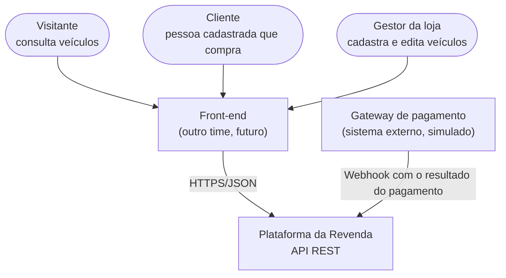
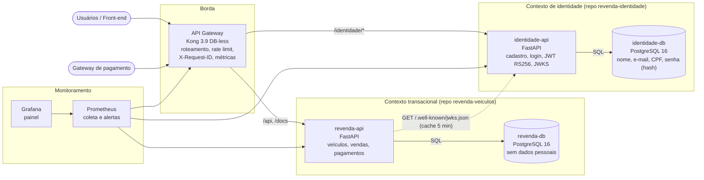
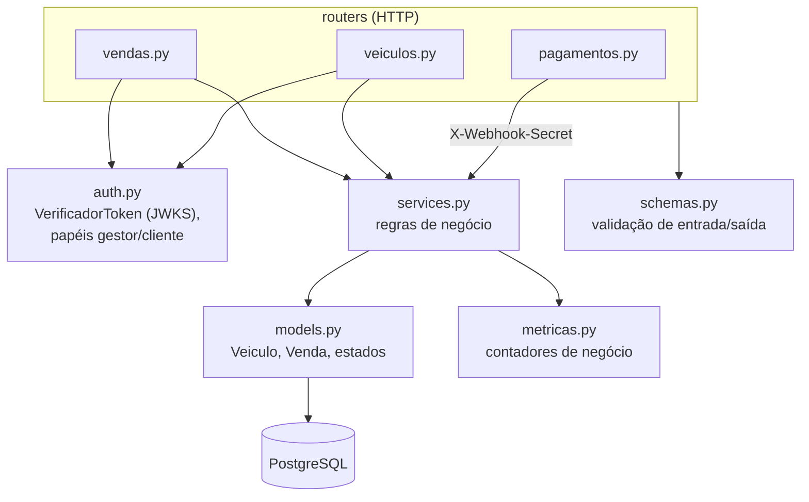
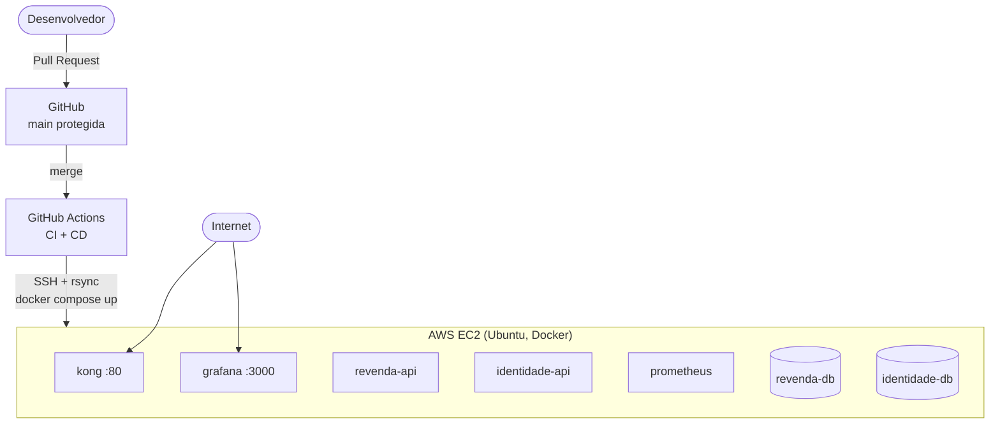
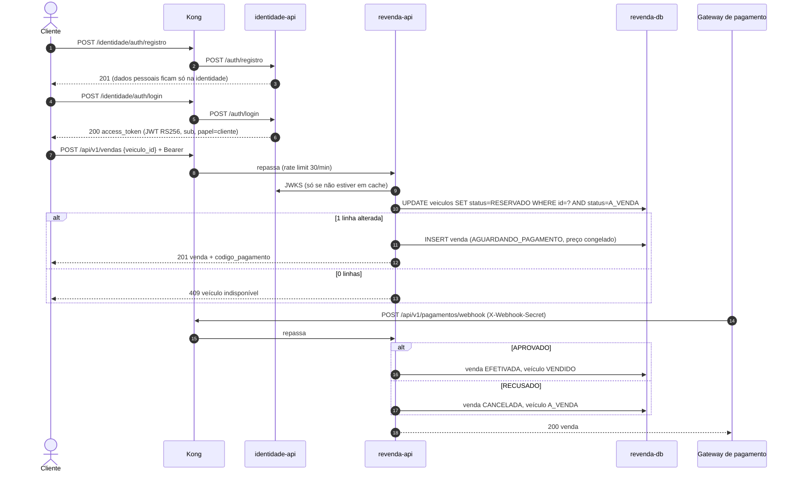
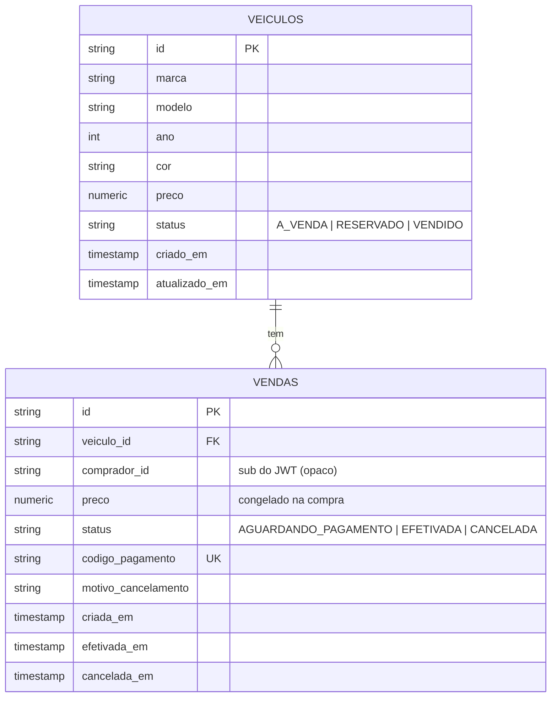
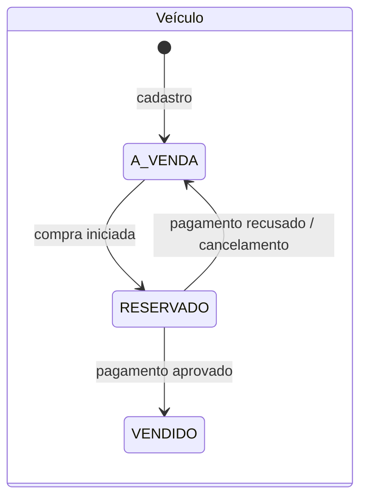
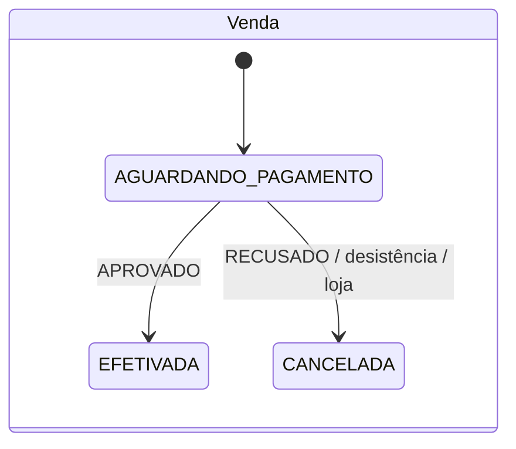

# Arquitetura

Documentação no modelo C4 (contexto, containers e componentes), mais a visão de implantação, a sequência da compra e o modelo de dados.

## 1. Contexto (C4 nível 1)

Enquanto o front-end não existe, os usuários usam o Swagger UI e o script de demonstração.

## 2. Containers (C4 nível 2)

Isolamento de rede: cada banco fica numa rede Docker `interna` do seu próprio projeto. Só as APIs, o Kong e o Prometheus compartilham a rede `revenda-net`. A revenda não consegue abrir conexão com o banco de identidade.

## 3. Componentes da revenda-api (C4 nível 3)

Os routers só traduzem HTTP; toda regra (reserva, efetivação, cancelamento, permissões de edição) está em `services.py`, que não conhece FastAPI.

## 4. Implantação

Os dois repositórios fazem deploy no mesmo servidor, cada um em sua pasta e projeto Compose, com `.env` próprio gerado a partir dos secrets do respectivo repositório.

## 5. Sequência: compra e efetivação

## 6. Modelo de dados (revenda-db)

Índices: `ix_veiculos_status_preco (status, preco)` atende às duas listagens ordenadas; `ux_vendas_veiculo_ativa` (único parcial, `WHERE status <> 'CANCELADA'`) impede duas vendas ativas para o mesmo veículo.

## 7. Máquinas de estado

